# NeuroCodec-TSE Supplementary Materials

## Overview

This repository provides qualitative audio and spectrogram examples for **NeuroCodec**, an EEG-Guided Latent-Domain Generative Model for High-Fidelity Target Speaker Extraction. Results are presented on the Cocktail Party and KUL datasets.

## Cocktail Party results

The Cocktail Party examples compare NeuroCodec with **M3ANet**, the existing state-of-the-art baseline used in this evaluation, and with an ablated NeuroCodec model trained without Mel and GAN losses. Evaluation is performed at **44.1 kHz**.

NeuroCodec qualitatively surpasses M3ANet through cleaner suppression of interfering speakers and full-bandwidth reconstruction. M3ANet operates at approximately 14.7 kHz sampling rate and is limited to about 7.3 kHz audio bandwidth, whereas NeuroCodec reconstructs at full-bandwith with 44.1 kHz sampling rate and preserves high-frequency cues. The ablation examples show that the Mel and adversarial losses improve harmonic structure, timbre, and perceptual naturalness.

Each sample is presented in the following order:

1. Mixture
2. Target
3. M3ANet
4. Ours (Neurocodec)
5. Without Mel and GAN losses

### Sample 1

| Method                                           | Spectrogram                                                                                                 | Audio                                                                                                  |
| ------------------------------------------------ | ----------------------------------------------------------------------------------------------------------- | ------------------------------------------------------------------------------------------------------ |
| Mixture                                          |                         | [Listen to `Mixture_1.wav`](Cocktail%20Party/Samples/Sample_1/Mixture_1.wav)                           |
| Target                                           |                           | [Listen to `Target_1.wav`](Cocktail%20Party/Samples/Sample_1/Target_1.wav)                             |
| M3ANet                                           |                 | [Listen to `Predicted_M3ANet_1.wav`](Cocktail%20Party/Samples/Sample_1/Predicted_M3ANet_1.wav)         |
| **Ours (Neurocodec)**                            |         | [Listen to `Predicted_Neurocodec_1.wav`](Cocktail%20Party/Samples/Sample_1/Predicted_Neurocodec_1.wav) |
| Without Mel and GAN losses _(lower performance)_ |  | [Listen to `Predicted_Lmse_Only_1.wav`](Cocktail%20Party/Samples/Sample_1/Predicted_Lmse_Only_1.wav)   |

### Sample 2

| Method                                           | Spectrogram                                                                                                 | Audio                                                                                                  |
| ------------------------------------------------ | ----------------------------------------------------------------------------------------------------------- | ------------------------------------------------------------------------------------------------------ |
| Mixture                                          |                         | [Listen to `Mixture_2.wav`](Cocktail%20Party/Samples/Sample_2/Mixture_2.wav)                           |
| Target                                           |                           | [Listen to `Target_2.wav`](Cocktail%20Party/Samples/Sample_2/Target_2.wav)                             |
| M3ANet                                           |                 | [Listen to `Predicted_M3ANet_2.wav`](Cocktail%20Party/Samples/Sample_2/Predicted_M3ANet_2.wav)         |
| **Ours (Neurocodec)**                            |         | [Listen to `Predicted_Neurocodec_2.wav`](Cocktail%20Party/Samples/Sample_2/Predicted_Neurocodec_2.wav) |
| Without Mel and GAN losses _(lower performance)_ |  | [Listen to `Predicted_Lmse_Only_2.wav`](Cocktail%20Party/Samples/Sample_2/Predicted_Lmse_Only_2.wav)   |

### Sample 3

| Method                                           | Spectrogram                                                                                                 | Audio                                                                                                  |
| ------------------------------------------------ | ----------------------------------------------------------------------------------------------------------- | ------------------------------------------------------------------------------------------------------ |
| Mixture                                          |                         | [Listen to `Mixture_3.wav`](Cocktail%20Party/Samples/Sample_3/Mixture_3.wav)                           |
| Target                                           |                           | [Listen to `Target_3.wav`](Cocktail%20Party/Samples/Sample_3/Target_3.wav)                             |
| M3ANet                                           |                 | [Listen to `Predicted_M3ANet_3.wav`](Cocktail%20Party/Samples/Sample_3/Predicted_M3ANet_3.wav)         |
| **Ours (Neurocodec)**                            |         | [Listen to `Predicted_Neurocodec_3.wav`](Cocktail%20Party/Samples/Sample_3/Predicted_Neurocodec_3.wav) |
| Without Mel and GAN losses _(lower performance)_ |  | [Listen to `Predicted_Lmse_Only_3.wav`](Cocktail%20Party/Samples/Sample_3/Predicted_Lmse_Only_3.wav)   |

## KUL results

Evaluation sampling rate: **8 kHz**. KUL is evaluated at 8 kHz because the original data is provided at 8 kHz.

> **KUL comparison limitation:** NeuroCodec has not been directly compared with **NeuroSpex+**, the state-of-the-art method reported for KUL, because its source code was not publicly provided and the method could not be reliably reproduced.

Each comparison contains the original mixture with multiple speakers, the clean ground-truth target, and the speech reconstructed by Neurocodec. These examples illustrate the model's generative extraction strategy.

### KUL Sample 0

| Method                | Spectrogram                                                                                  | Audio                                                                     |
| --------------------- | -------------------------------------------------------------------------------------------- | ------------------------------------------------------------------------- |
| Mixture               | 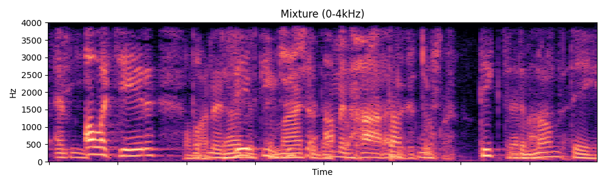                  | [Listen to `0_mixture.wav`](KUL/Samples/Sample_0/0_mixture.wav)           |
| Target                | 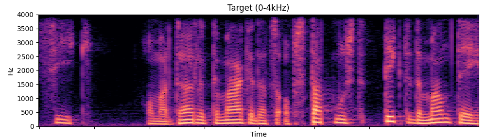                    | [Listen to `0_target_clean.wav`](KUL/Samples/Sample_0/0_target_clean.wav) |
| **Ours (Neurocodec)** | 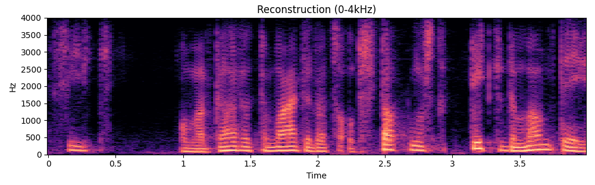 | [Listen to `0_prediction..wav`](KUL/Samples/Sample_0/0_prediction..wav)   |

### KUL Sample 1

| Method                | Spectrogram                                                                                  | Audio                                                                     |
| --------------------- | -------------------------------------------------------------------------------------------- | ------------------------------------------------------------------------- |
| Mixture               | 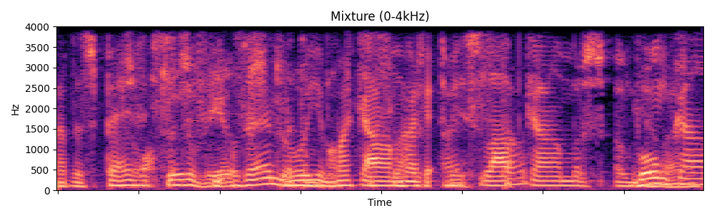                  | [Listen to `1_mixture.wav`](KUL/Samples/Sample_1/1_mixture.wav)           |
| Target                | 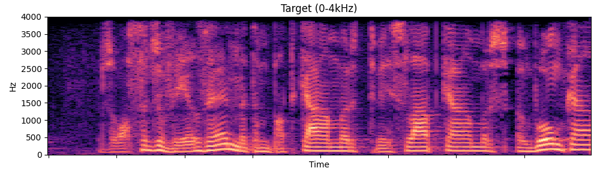                    | [Listen to `1_target_clean.wav`](KUL/Samples/Sample_1/1_target_clean.wav) |
| **Ours (Neurocodec)** |  | [Listen to `1_prediction.wav`](KUL/Samples/Sample_1/1_prediction.wav)     |

### KUL Sample 2

| Method                | Spectrogram                                                                                  | Audio                                                                     |
| --------------------- | -------------------------------------------------------------------------------------------- | ------------------------------------------------------------------------- |
| Mixture               | 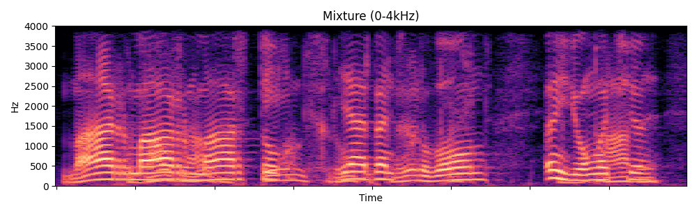                  | [Listen to `2_mixture.wav`](KUL/Samples/Sample_2/2_mixture.wav)           |
| Target                | 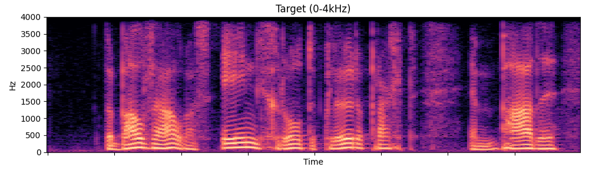                    | [Listen to `2_target_clean.wav`](KUL/Samples/Sample_2/2_target_clean.wav) |
| **Ours (Neurocodec)** | 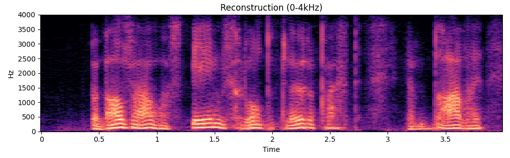 | [Listen to `2_prediction.wav`](KUL/Samples/Sample_2/2_prediction.wav)     |

### KUL Sample 3

| Method                | Spectrogram                                                                                  | Audio                                                                     |
| --------------------- | -------------------------------------------------------------------------------------------- | ------------------------------------------------------------------------- |
| Mixture               | 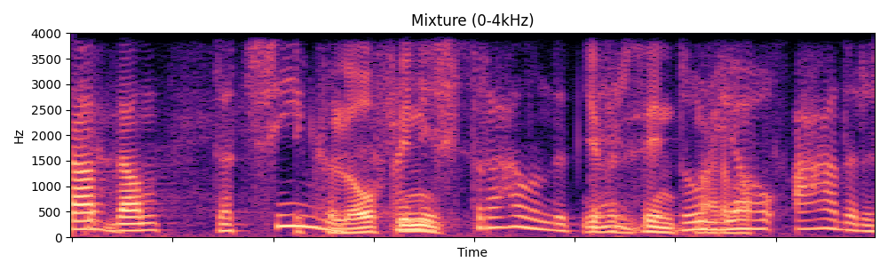                  | [Listen to `3_mixture.wav`](KUL/Samples/Sample_3/3_mixture.wav)           |
| Target                | 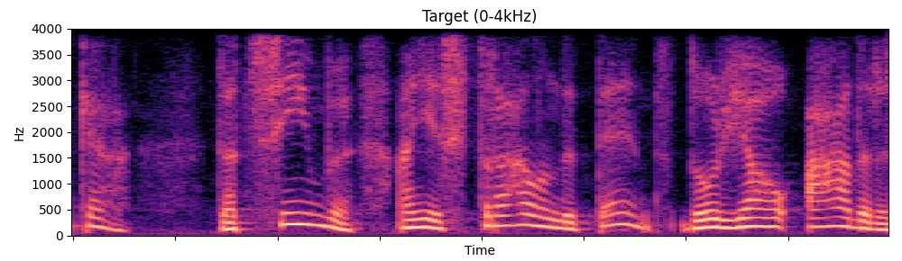                    | [Listen to `3_target_clean.wav`](KUL/Samples/Sample_3/3_target_clean.wav) |
| **Ours (Neurocodec)** | 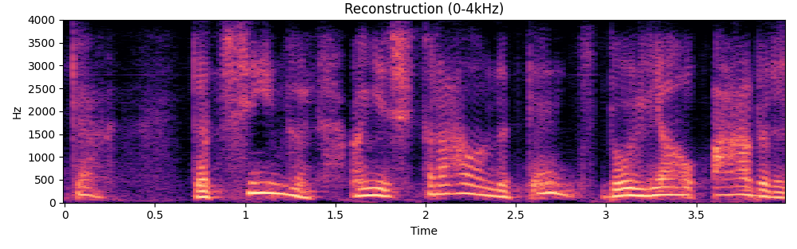 | [Listen to `3_prediction.wav`](KUL/Samples/Sample_3/3_prediction.wav)     |

## Directory structure

```text
NeuroCodec-TSE/
|-- README.md
|-- Cocktail Party/
|   `-- Samples/
|       |-- Sample_1/
|       |-- Sample_2/
|       `-- Sample_3/
`-- KUL/
    `-- Samples/
        |-- Sample_0/
        |-- ...
        `-- Sample_4/
```
