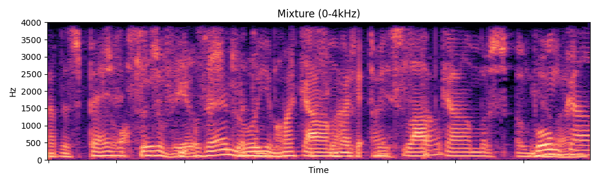
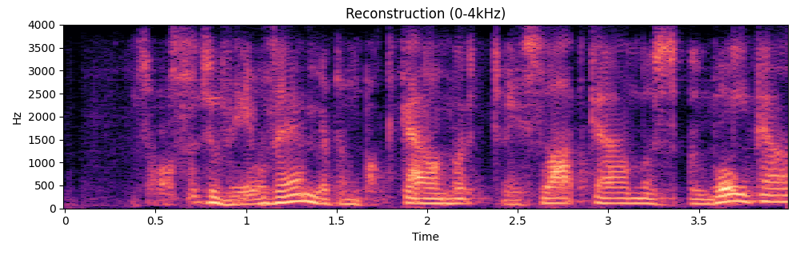

# Neurocodec Supplementary Materials

This repository provides qualitative comparisons for **Neurocodec** on the Cocktail Party and KUL datasets. **M3ANet** is the existing state-of-the-art (SOTA) baseline model.

Each sample is presented in the following order:

1. Mixture
2. Target
3. M3ANet
4. Ours (Neurocodec)
5. Without Mel and GAN losses

> **Audio playback:** Select a **Listen to audio** link to open or download the corresponding WAV file. Some Markdown viewers play WAV files directly; others open them in a separate browser tab or media player.

## Key highlights

1. **Full-bandwidth reconstruction - Neurocodec vs. M3ANet:** M3ANet is band-limited to approximately 14.7 kHz sampling rate, with a sharp cutoff around 7.3 kHz, while Neurocodec reconstructs at 44.1 kHz and preserves high-frequency cues.
2. **Generative vs. discriminative extraction - Neurocodec vs. M3ANet:** M3ANet uses masking and can leak interfering speech. Neurocodec uses a generative strategy to synthesize the target voice and better suppress background-speaker interference.
3. **Impact of Mel and GAN losses - Neurocodec vs. the ablated model:** Mel loss preserves harmonic structure and timbre, while adversarial loss reduces robotic over-smoothing and improves perceptual naturalness. The **Without Mel and GAN losses** rows illustrate this degradation.

## Cocktail Party results

Evaluation sampling rate: **44.1 kHz**.

### Sample 1

| Method | Spectrogram | Audio |
|---|---|---|
| Mixture |  | [Listen to `Mixture_1.wav`](Cocktail%20Party/Samples/Sample_1/Mixture_1.wav) |
| Target |  | [Listen to `Target_1.wav`](Cocktail%20Party/Samples/Sample_1/Target_1.wav) |
| M3ANet |  | [Listen to `Predicted_M3ANet_1.wav`](Cocktail%20Party/Samples/Sample_1/Predicted_M3ANet_1.wav) |
| **Ours (Neurocodec)** |  | [Listen to `Predicted_Neurocodec_1.wav`](Cocktail%20Party/Samples/Sample_1/Predicted_Neurocodec_1.wav) |
| Without Mel and GAN losses *(lower performance)* |  | [Listen to `Predicted_Lmse_Only_1.wav`](Cocktail%20Party/Samples/Sample_1/Predicted_Lmse_Only_1.wav) |

### Sample 2

| Method | Spectrogram | Audio |
|---|---|---|
| Mixture |  | [Listen to `Mixture_2.wav`](Cocktail%20Party/Samples/Sample_2/Mixture_2.wav) |
| Target |  | [Listen to `Target_2.wav`](Cocktail%20Party/Samples/Sample_2/Target_2.wav) |
| M3ANet |  | [Listen to `Predicted_M3ANet_2.wav`](Cocktail%20Party/Samples/Sample_2/Predicted_M3ANet_2.wav) |
| **Ours (Neurocodec)** |  | [Listen to `Predicted_Neurocodec_2.wav`](Cocktail%20Party/Samples/Sample_2/Predicted_Neurocodec_2.wav) |
| Without Mel and GAN losses *(lower performance)* |  | [Listen to `Predicted_Lmse_Only_2.wav`](Cocktail%20Party/Samples/Sample_2/Predicted_Lmse_Only_2.wav) |

### Sample 3

| Method | Spectrogram | Audio |
|---|---|---|
| Mixture |  | [Listen to `Mixture_3.wav`](Cocktail%20Party/Samples/Sample_3/Mixture_3.wav) |
| Target |  | [Listen to `Target_3.wav`](Cocktail%20Party/Samples/Sample_3/Target_3.wav) |
| M3ANet |  | [Listen to `Predicted_M3ANet_3.wav`](Cocktail%20Party/Samples/Sample_3/Predicted_M3ANet_3.wav) |
| **Ours (Neurocodec)** |  | [Listen to `Predicted_Neurocodec_3.wav`](Cocktail%20Party/Samples/Sample_3/Predicted_Neurocodec_3.wav) |
| Without Mel and GAN losses *(lower performance)* |  | [Listen to `Predicted_Lmse_Only_3.wav`](Cocktail%20Party/Samples/Sample_3/Predicted_Lmse_Only_3.wav) |

## KUL results

Evaluation sampling rate: **8 kHz**. KUL is evaluated at 8 kHz because the original data is provided at 8 kHz.

Each comparison contains the original mixture with multiple speakers, the clean ground-truth target, and the speech reconstructed by Neurocodec. These examples illustrate the model's generative extraction strategy: it reconstructs the target voice from neural signals while suppressing the interfering speaker.

### KUL Sample 0

| Method | Spectrogram | Audio |
|---|---|---|
| Mixture |  | [Listen to `0_mixture.wav`](KUL/Samples/Sample_0/0_mixture.wav) |
| Target |  | [Listen to `0_target_clean.wav`](KUL/Samples/Sample_0/0_target_clean.wav) |
| **Ours (Neurocodec)** |  | [Listen to `0_prediction..wav`](KUL/Samples/Sample_0/0_prediction..wav) |

### KUL Sample 1

| Method | Spectrogram | Audio |
|---|---|---|
| Mixture |  | [Listen to `1_mixture.wav`](KUL/Samples/Sample_1/1_mixture.wav) |
| Target |  | [Listen to `1_target_clean.wav`](KUL/Samples/Sample_1/1_target_clean.wav) |
| **Ours (Neurocodec)** |  | [Listen to `1_prediction.wav`](KUL/Samples/Sample_1/1_prediction.wav) |

### KUL Sample 2

| Method | Spectrogram | Audio |
|---|---|---|
| Mixture |  | [Listen to `2_mixture.wav`](KUL/Samples/Sample_2/2_mixture.wav) |
| Target |  | [Listen to `2_target_clean.wav`](KUL/Samples/Sample_2/2_target_clean.wav) |
| **Ours (Neurocodec)** |  | [Listen to `2_prediction.wav`](KUL/Samples/Sample_2/2_prediction.wav) |

### KUL Sample 3

| Method | Spectrogram | Audio |
|---|---|---|
| Mixture |  | [Listen to `3_mixture.wav`](KUL/Samples/Sample_3/3_mixture.wav) |
| Target |  | [Listen to `3_target_clean.wav`](KUL/Samples/Sample_3/3_target_clean.wav) |
| **Ours (Neurocodec)** |  | [Listen to `3_prediction.wav`](KUL/Samples/Sample_3/3_prediction.wav) |

### KUL Sample 4

| Method | Spectrogram | Audio |
|---|---|---|
| Mixture |  | [Listen to `4_mixture.wav`](KUL/Samples/Sample_4/4_mixture.wav) |
| Target |  | [Listen to `4_target_clean.wav`](KUL/Samples/Sample_4/4_target_clean.wav) |
| **Ours (Neurocodec)** |  | [Listen to `4_prediction.wav`](KUL/Samples/Sample_4/4_prediction.wav) |

## Datasets and sampling rates

### Cocktail Party

- Location: [`Cocktail Party/`](Cocktail%20Party/)
- Purpose: model-output comparisons for the Cocktail Party dataset.
- Evaluation sampling rate: **44.1 kHz**.
- Each `Samples/Sample_*` directory contains the mixture, target, M3ANet prediction, Neurocodec prediction, and ablated Neurocodec output, together with the corresponding spectrograms.

### KUL

- Location: [`KUL/`](KUL/)
- Purpose: mixture, target, and prediction outputs for the KUL dataset, together with the corresponding spectrogram plots.
- Evaluation sampling rate: **8 kHz**.
- KUL is evaluated at 8 kHz because the original KUL data is provided at 8 kHz.

## Directory structure

```text
Neurocodec_Supplementary/
├── README.md
├── Cocktail Party/
│   └── Samples/
│       ├── Sample_1/
│       ├── Sample_2/
│       └── Sample_3/
└── KUL/
    └── Samples/
```

